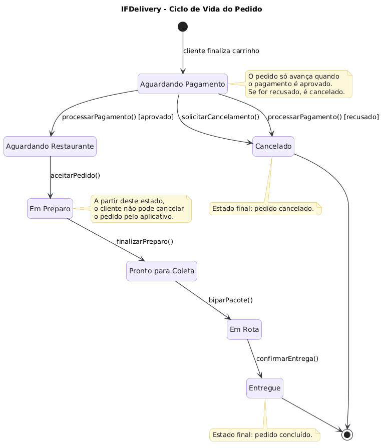
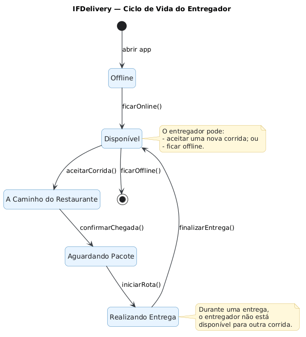

# IFDelivery — Modelagem do Ciclo de Vida

## 1. Introdução

O IFDelivery é um sistema de entrega de pedidos que envolve diferentes etapas, desde a confirmação do pagamento até a entrega ao cliente. Para que essas etapas ocorram corretamente, o sistema precisa controlar o estado atual de cada objeto e permitir apenas as transições previstas nas regras de negócio.

Nesta atividade, foram desenvolvidos dois diagramas de estados UML: um para o módulo **Pedido** e outro para o módulo **Entregador**. Cada diagrama representa o ciclo de vida de uma entidade, seus estados possíveis e os eventos responsáveis pelas mudanças de estado.

## 2. O que é um Diagrama de Estados?

O diagrama de estados UML é uma representação visual do comportamento de um objeto ao longo de seu ciclo de vida. Ele mostra os estados em que o objeto pode se encontrar, os eventos que provocam mudanças e as condições que precisam ser atendidas para que determinadas transições aconteçam.

Seus principais elementos são:

- **Estado:** representa uma situação em que o objeto se encontra.
- **Transição:** indica a passagem de um estado para outro.
- **Evento:** ação que provoca uma transição.
- **Condição de guarda:** requisito que precisa ser verdadeiro para permitir uma transição.
- **Estado inicial:** indica o início do ciclo de vida.
- **Estado final:** representa o encerramento do ciclo de vida do objeto.

Na modelagem do IFDelivery, esses elementos permitem representar as regras que o sistema deve respeitar durante o processamento dos pedidos e a realização das entregas.

## 3. Módulo Pedido

O módulo `Pedido` representa o ciclo de vida de um pedido realizado pelo cliente. Seu fluxo começa quando o cliente finaliza o carrinho e termina quando o pedido é entregue ou cancelado.

### Diagrama de estados

### Funcionamento

O pedido começa no estado **Aguardando Pagamento**. Nesse momento, o cliente pode solicitar o cancelamento. O processamento do pagamento determina qual será a próxima etapa:

- Se o pagamento for aprovado, o pedido passa para **Aguardando Restaurante**.
- Se o pagamento for recusado, o pedido passa para **Cancelado**.

Após receber o pedido, o restaurante aciona `aceitarPedido()`, levando-o ao estado **Em Preparo**. Quando o preparo termina, o evento `finalizarPreparo()` altera o estado para **Pronto para Coleta**.

Quando o entregador realiza a leitura do pacote por meio de `biparPacote()`, o pedido passa para **Em Rota**. Finalmente, o evento `confirmarEntrega()` leva o pedido ao estado **Entregue**, encerrando seu ciclo de vida.

### Estados e transições

| Estado atual | Evento ou condição | Próximo estado |
|---|---|---|
| Aguardando Pagamento | `solicitarCancelamento()` | Cancelado |
| Aguardando Pagamento | `processarPagamento() [aprovado]` | Aguardando Restaurante |
| Aguardando Pagamento | `processarPagamento() [recusado]` | Cancelado |
| Aguardando Restaurante | `aceitarPedido()` | Em Preparo |
| Em Preparo | `finalizarPreparo()` | Pronto para Coleta |
| Pronto para Coleta | `biparPacote()` | Em Rota |
| Em Rota | `confirmarEntrega()` | Entregue |

### Regras de negócio

O pagamento deve ser aprovado antes de o pedido avançar para o restaurante. Além disso, o cancelamento pelo cliente é permitido somente enquanto o pedido está em **Aguardando Pagamento**, conforme as regras fornecidas na atividade.

Essa restrição impede que o cliente cancele o pedido pelo aplicativo depois que o restaurante começou a prepará-lo ou depois que o pacote já foi encaminhado para entrega.

Os estados finais desse módulo são **Entregue** e **Cancelado**.

## 4. Módulo Entregador

O módulo `Entregador` representa o ciclo de vida do profissional responsável por transportar os pedidos até os clientes.

Diferentemente do pedido, que segue um fluxo até seu encerramento, o entregador pode concluir várias corridas durante uma mesma sessão. Por isso, seu diagrama possui um ciclo de repetição.

### Diagrama de estados

### Funcionamento

O entregador começa no estado **Offline**. Quando aciona `ficarOnline()`, passa para **Disponível**, indicando que pode receber uma nova corrida.

Ao aceitar uma corrida por meio de `aceitarCorrida()`, muda para **A Caminho do Restaurante**. Ao chegar ao estabelecimento e acionar `confirmarChegada()`, passa para **Aguardando Pacote**.

Depois de receber o pedido, o entregador aciona `iniciarRota()`, entrando no estado **Realizando Entrega**. Quando chega ao destino e aciona `finalizarEntrega()`, retorna para **Disponível**.

Esse retorno é importante: o entregador não encerra seu ciclo de vida após uma única entrega. Ele pode aceitar outra corrida e repetir o processo. O estado final só é alcançado quando, estando disponível, aciona `ficarOffline()`.

### Estados e transições

| Estado atual | Evento | Próximo estado |
|---|---|---|
| Inicial | Abertura do aplicativo | Offline |
| Offline | `ficarOnline()` | Disponível |
| Disponível | `aceitarCorrida()` | A Caminho do Restaurante |
| A Caminho do Restaurante | `confirmarChegada()` | Aguardando Pacote |
| Aguardando Pacote | `iniciarRota()` | Realizando Entrega |
| Realizando Entrega | `finalizarEntrega()` | Disponível |
| Disponível | `ficarOffline()` | Estado final |

### Regras de negócio

O sistema só deve permitir que um entregador aceite uma corrida quando estiver no estado **Disponível**. Enquanto estiver a caminho do restaurante, aguardando o pacote ou realizando uma entrega, ele não deve receber uma nova corrida como se estivesse livre.

A transição de **Realizando Entrega** para **Disponível** representa a conclusão de uma corrida, e não o encerramento da atividade do entregador.

## 5. Relação dos diagramas com os problemas identificados

Os dois diagramas ajudam a identificar e prevenir comportamentos indevidos no sistema:

- **Cancelamento após a coleta:** o diagrama de `Pedido` restringe o cancelamento pelo cliente ao estado Aguardando Pagamento.
- **Atribuição de corrida a um entregador ocupado:** o diagrama de `Entregador` permite aceitar uma corrida somente a partir do estado Disponível.
- **Preparação antes da aprovação do pagamento:** o fluxo do pedido exige a aprovação do pagamento antes da chegada ao estado Aguardando Restaurante e, consequentemente, antes do início do preparo.

A modelagem torna as regras mais claras para a equipe de desenvolvimento e ajuda a identificar quais transições devem ser permitidas ou bloqueadas na implementação.

É importante destacar que os diagramas descrevem o comportamento esperado do sistema. Para garantir essas regras na prática, a aplicação também precisa validar as transições no código do servidor, evitando que requisições inválidas alterem o estado dos objetos.

## 6. Conclusão

A modelagem dos módulos `Pedido` e `Entregador` permite compreender como cada entidade se comporta ao longo de seu ciclo de vida. O pedido possui um fluxo com etapas definidas e termina quando é entregue ou cancelado. O entregador, por sua vez, possui um ciclo repetitivo, retornando à disponibilidade após cada entrega até decidir ficar offline.

Dessa forma, os diagramas de estados UML contribuem para a organização das regras de negócio, a prevenção de inconsistências e o desenvolvimento de um sistema de entregas mais confiável.
